# Circuit Breaker Tracker

[](https://github.com/rbibby53/Circuit-breaker-tracker/actions/workflows/ci.yml)
[](https://github.com/rbibby53/Circuit-breaker-tracker/pkgs/container/circuit-breaker-tracker)
[](LICENSE)

A self-hosted web app for recreating your electrical panels, labelling what every breaker
does, sharing them with the right people, and printing panel directories as PDFs. It runs
as a single Docker container with its data in one SQLite file.

> **Status: 1.4.0, stable.** Accounts with scoped access, Microsoft, Authentik and Keycloak
> sign-in, the panel editor for load centers, 3-phase panelboards, switchboards, MCCs and
> lighting relay panels, transformers and disconnects, generators and transfer switches, a power
> flow map, connected load and capacity checks, an equipment register, field verification on a
> phone (also offline), shutdown impact, spreadsheet import, printing, logs and automatic
> backups, and read-only API tokens for scripts. Upgrades are automatic; see
> [Upgrading](docs/install.md#upgrading). What could come next is in [docs/PLAN.md](docs/PLAN.md).


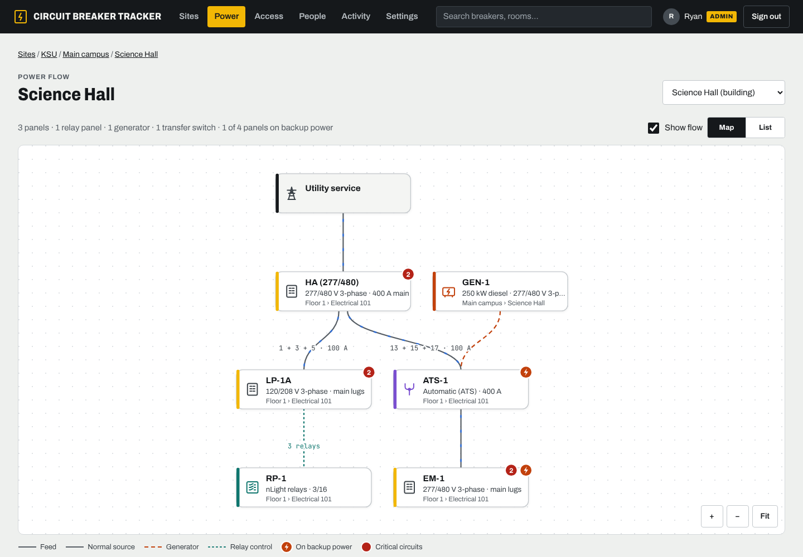

## What works today

- **Locations:** Company → Site → Building → Floor → Room. For homes, add floors straight
  to the site and the building level stays hidden.
- **Scoped access:** give someone **Viewer**, **Editor** or **Manager** on any location. A
  grant covers everything inside that location, and nothing outside it.
- **Manager invite limits:** a manager can only invite people inside their own scope, and
  only up to their limit (_Viewers only_, _Viewers and editors_, or _Up to managers_).
- **Two ways to sign in:** single sign-on with Microsoft Entra ID, Authentik or any OIDC
  provider, and local accounts with passwords for family, roommates and anyone without one.
- **Access from SSO groups:** give everyone in an Authentik (or Entra, Keycloak…) group
  access to a location, make members of an admin group admins, or only let certain groups
  sign in. Accounts are made on first sign-in for people whose groups give them access.
  Nested groups count for the groups above them (see [Groups](docs/sign-in.md#groups)).
- **Two-step sign-in** for password accounts: a code from an authenticator app, with
  one-time recovery codes. Whoever can send someone a reset link can also turn it off for
  them if they lose their phone.
- **Invite and reset links:** one-time links you copy and send yourself, so no email server
  is needed.
- **People page:** find anyone by name, email or location, and open **Manage access** to see
  everywhere they have access, change a role, remove access or grant a new location in one
  place, and set their name and email. You can also invite someone from there.
- **Profile pictures from [Gravatar](https://gravatar.com)** for people with an email: added
  under Your account, by an admin or manager under People, or from their single sign-on.
  Everyone else gets initials. Browsers fetch the pictures straight from
  gravatar.com using a hash of the email; admins can turn this off in Settings.
- **Where you're signed in:** Your account lists each browser with its address and when it
  was last used, and can sign out any of them or all the others. Managers and admins can sign
  someone out everywhere from People.
- **View as user:** admins can see the app exactly as someone else sees it, read-only.
- **Activity log:** every change is recorded, grouped by day, with a filter and links to the
  panel or room. Managers see the changes inside their scope.
- **Works on phones:** the panel, search and public pages fit a phone screen, and the location
  tree folds away so the page comes first.
- **Panel editor** for residential load centers and commercial panelboards:
  - Odd spaces on the left, even on the right. Click an empty space to add a breaker, drag
    to move it, and pick 1-pole, 2-pole or tandem (21A / 21B).
  - **Three-phase panelboards** (120/208 V, 277/480 V): rows are labelled with phases A, B
    and C, and breakers can be 1-, 2- or 3-pole. Each breaker shows the phases it is on and
    its voltage (120 V, 208 V…). No tandems, and space counts come in multiples of 6 (30, 42,
    84…), as on real panelboards.
  - Set amps, protection (standard, GFCI, AFCI, dual function), a **critical** flag,
    **backup power** (UPS or generator) and spare.
  - Tag what each breaker **serves**: rooms on any floor, a whole floor or building, or
    the whole site.
  - Changes save automatically, with undo and redo (Ctrl+Z / Ctrl+Shift+Z). If two people
    edit at once, the second save is refused instead of silently overwriting.
  - **Tags** for what a breaker powers (Lights, Outlets, Servers…), suggested from tags already
    in use. Search finds breakers by tag, and a tag bar on each panel highlights every breaker
    with that tag.
  - **History** shows every change in plain words.
- **Switchboards and motor control centers:** units numbered 1, 2A, 2B… in a list, up to 200,
  each with its frame and trip, poles, feeder wire and conduit; MCC buckets add the starter
  size, motor HP and control type (FVNR, VFD…).
- **Panels with sections:** up to 6 sections in one panel, each numbered from 1 and optionally
  fed through lugs, for double-tub panels and anything past 84 spaces. Circuits read
  "S2 · 1 + 3 + 5".
- **Panel nameplate:** short-circuit rating (AIC/SCCR), bus rating separate from the main,
  mounting, enclosure, and feeder wire and conduit.
- **Connected load:** each breaker's load in VA (or kVA) with a demand factor, filled in from
  labels that already say "1200 VA". Each panel shows the load on each phase in VA and amps,
  how far out of balance it is, and connected and demand totals.
- **Capacity check:** demand is added up below every panel, through sub-panels and
  transformers, and compared with the main or bus, the feeder breaker and the nearest
  transformer or UPS. Anything at 80% or more is flagged.
- **Voltage warnings:** a panel fed at another voltage with no transformer between, a
  transformer whose voltages don't match either side, 3-pole breakers on a single-phase panel,
  and equipment rated for another voltage.
- **Transformers, disconnects, UPSs and the utility service:** each fed from a breaker or from
  each other, with kVA and primary and secondary voltage, fused or non-fused amps, UPS
  runtime, or the meter and utility. Panels can be fed from them, and the power path, map,
  PDFs and CSV show the step, e.g. HA 480 V → T-LDP1 (75 kVA · 480 V → 120/208 V) → LP-1A.
- **Campus grids:** for sites that run their own distribution, **switching cubes** (pad-mounted
  medium-voltage switchgear, e.g. 12.47 kV) feed each building's transformer or main switchboard
  through a numbered way. Each building page shows the cube and way it ties back to, each cube
  lists the buildings it feeds, and the power path and map show the way ("SC-2 · Way 3").
- **Meters:** your own meters on switchgear, panels and circuits, with meter number, make, model,
  serial, CT and PT ratios, multiplier, and how it talks (Modbus TCP/RTU, BACnet IP/MS-TP, pulse)
  with its address. A meter measures a breaker's circuit (a meter fed from a breaker), a panel or
  switchboard at its main, or a cube or transformer. Panels, breakers and devices list their
  meters, and search finds them by name, number or serial.
- **Equipment register:** AHU-1, EF-2, RTU-3 and the rest, with type, HP, voltage, room, and
  the breaker or disconnect feeding it. Search "AHU-2" to see what feeds it; breakers list
  the equipment on them.
- **Room links from labels:** a building's page suggests which rooms a breaker serves when its
  label names a room number ("RECEPT ROOM 3002" → Room 3002), to accept in bulk.
- **Field verification:** mark each circuit or meter verified or wrong, with who and when, filter
  for the ones not yet checked, and see progress by site, building and panel ("Science Hall: 62%
  verified"). **Who verified what** lists every check, newest first, with a count per person,
  filtered by place, person or result.
- **Select several** breakers to set amps, poles, tags or the field check together, or move a
  range up or down.
- **Field mode** for walking a panel with a phone: one circuit per row in big type, with
  **Matches** and **Doesn't match** buttons. "Doesn't match" sends a report to whoever looks
  after the panel. **Save for offline** keeps a building's panels on the phone, so field mode
  opens in rooms with no signal; checks and reports wait on the phone and are sent when you are
  back online. (Offline needs the app on HTTPS or localhost.)
- **Reports:** anyone can say something doesn't match, from field mode or from a panel's public
  page after scanning its door sticker. Editors see open reports on the panel and on
  **Reports**, and resolve them with a note.
- **Shutdown impact:** **What loses power?** on any breaker, panel, transformer or disconnect
  lists every panel, piece of equipment, relay, room and critical circuit downstream, for
  lockout/tagout and outage notices. Panels on a transfer switch and loads on a UPS are shown as
  staying up. Copy it as text.
- **Import from a spreadsheet:** paste cells or choose a CSV, match the columns (this app's own
  export reads straight back in), and review every panel and circuit that would be added or
  changed, with row-numbered problems, before anything is saved. Each panel's history shows
  the import.
- **Surge protectors** that install in breaker spaces, with or without breakers of their own.
  They are marked SPD in the panel, on PDFs and in CSV exports.
- **Standby generators** for a site or building: size (kW), fuel, voltage, make and model.
  Panels fed from a generator-backed panel are on the generator too. Panels, PDFs and CSV
  exports say which generator backs them, and each generator lists every panel it backs up.
- **Transfer switches** (automatic or manual) on each generator's page, with their rating,
  duty (emergency, legally required or optional standby; NEC 700/701/702), transition and
  priority, and where they are. Generators record their fuel tank and runtime. Put a panel on one under **Panel settings → Backup power**: its normal side
  is the panel's Fed from breaker, its emergency side the generator.
- **Power flow map** (**Power** in the menu, or **Power flow** on a site, building, panel or
  generator), in the spirit of a network topology view. It draws the utility, every panel and
  the sub-panels it feeds, transfer switches with their normal and generator sources, and the
  relay panels switching circuits. Hover or tap anything to light up its whole path, click to
  open it, pan and zoom, and switch to a list on a phone or with a screen reader. Panels
  upstream that you cannot see are shown as locked boxes, so the path still makes sense.
- **Power path on every panel:** a strip from the utility through each panel feeding it, with
  the circuit it is on, and the generator backing it up.
- **Lighting relay panels**, such as Acuity **nLight** relay panels: a numbered column of 1-
  and 2-pole relays. For each relay, record the breaker whose circuit it switches (in any
  breaker panel), its control (nLight zone, channel, schedule, occupancy…) and the rooms it
  lights. The breaker shows **Switched by RP-1 relay 5**, and search finds relays by zone.
- **Panel summary:** circuits, spares and free spaces under each panel, and how evenly
  breaker ratings are spread across the legs (split-phase) or phases A/B/C (3-phase).
- **Sub-panels:** set which breaker feeds a panel. Anyone who can see a panel also sees
  what feeds it, all the way up to the service, even when the upstream panels are outside
  their access.
- **Breakers serving a room:** each room and floor page lists every breaker that serves it,
  from any panel, including whole-floor and whole-site tags.
- **Print to PDF** (the **Print** button on any panel or location), with who printed it and
  when on every page:
  - **Panel sheet:** a full page laid out like the panel, odd numbers left and even right.
    It shows what each breaker serves, its markers and the panel's notes.
  - **Door card:** a 4-inch-wide card to cut out and keep inside the panel door.
  - **Breaker labels:** a sticker sheet with one label per circuit (Avery 5167 on Letter, Avery
    L7651 on A4), or strips to stick beside each column of breakers at 1" or ¾" spacing. Print
    these at 100%.
  - **QR door stickers:** a 2-inch square for the outside of each panel door (Avery 22806 on
    Letter), for one panel or every panel in a building. Scanning opens the panel's public
    page if it has one, or field mode.
  - **Room index:** every room grouped by floor, with the breakers that serve it.
  - **Panel book:** a cover with contents, a sheet for every panel in a site, building or
    floor, then the room index.
  - Markers are printed as text (CRIT, UPS, GEN, GFCI, AFCI, DF, SPD), so they read fine in black
    and white. Each sheet has a QR code that opens the panel on a phone.
  - US Letter or A4. People only ever print what they are allowed to see.
- **Public panel pages from the QR code:** a manager can let anyone who scans a panel's QR
  code see it without signing in. It is a read-only, phone-friendly list with a search box,
  a **Report a problem** button and a **Sign in to edit** button. The link is unguessable and can be replaced or turned
  off, and an admin can switch public pages off everywhere.
- **CSV export:** every breaker of a panel, or of everything under a location, for Excel,
  Numbers or Google Sheets (from the same **Print & export** button).
- **API tokens for scripts:** read-only tokens made under **Account**, so a script can fetch
  the same CSV or JSON you see in the browser, including with single sign-on accounts. See
  [API for scripts](docs/api.md).
- **Duplicate a panel** into another room, e.g. for identical apartments. Room tags come
  along inside the same site.

## Screenshots

|                                                                                                   |                                                                          |
| ------------------------------------------------------------------------------------------------- | ------------------------------------------------------------------------ |
|                                                     |                    |
| Dark mode follows your system, or pick one under Account. Leg balance shows the load on each leg. | Press <kbd>/</kbd> to search rooms, panels, breakers and tags.           |
|                                                   |                                |
| Grant access on any location; managers only invite within their scope.                            | Admins configure the app in Settings instead of Docker.                  |
| 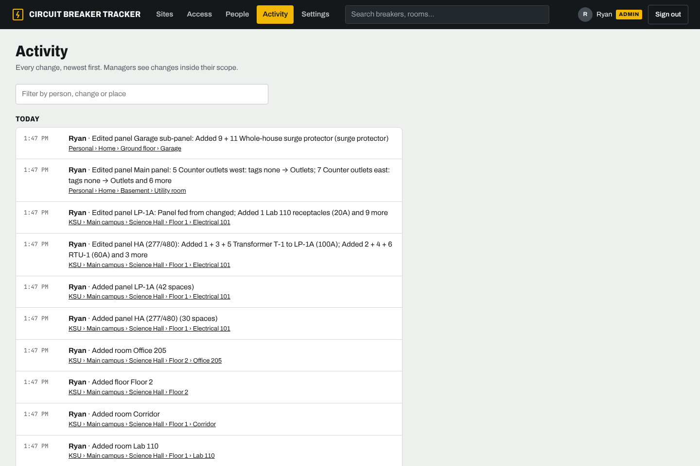                                                        | 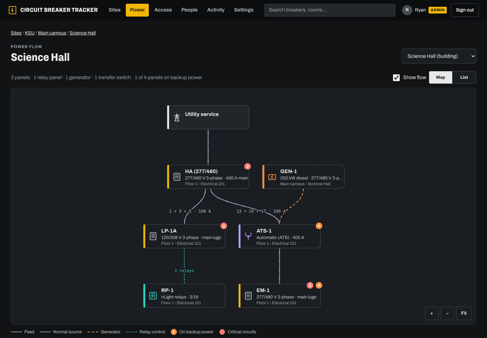 |
| Every change, newest first, linked to where it happened. Filter by person, change or place.       | The power flow map: hover anything to light up its whole path.           |

<p align="center"></p>

### New in 1.3

|                                                                                                        |                                                                                         |
| ------------------------------------------------------------------------------------------------------ | --------------------------------------------------------------------------------------- |
| 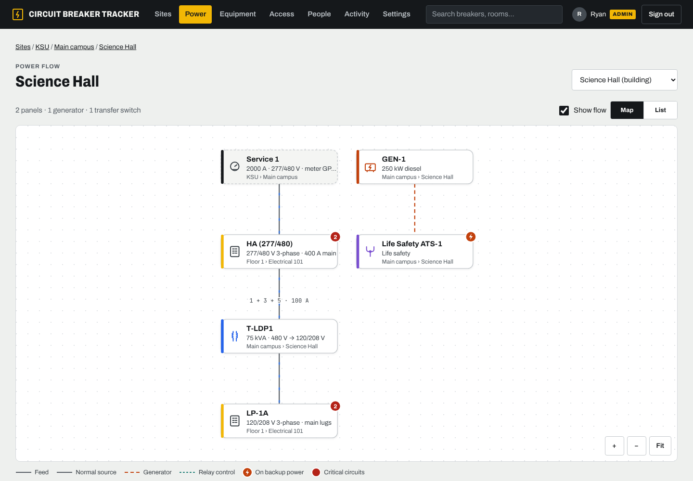                         | 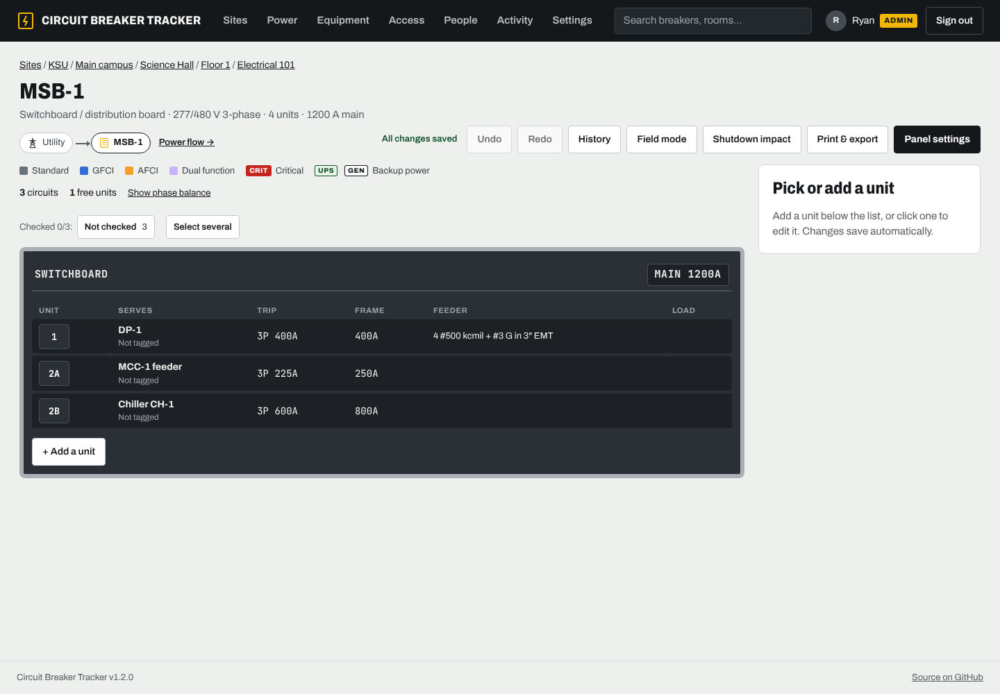                              |
| The service, a panel, the 75 kVA transformer stepping 480 V down to 120/208 V, and the panel it feeds. | A switchboard lists its units with frame, trip and feeder.                              |
| 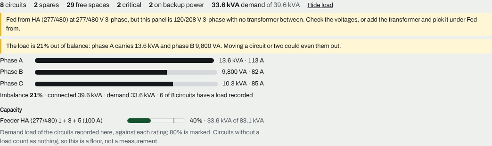                               | 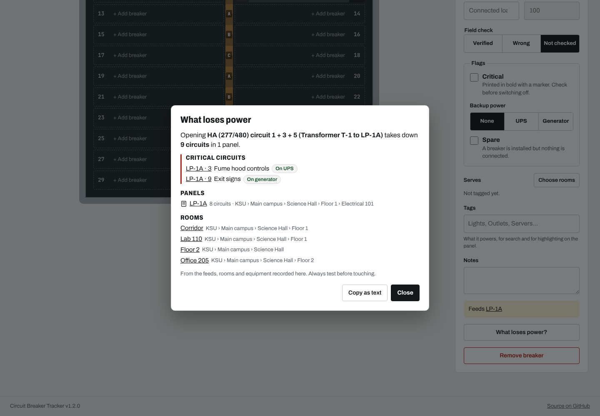                               |
| Load per phase, imbalance, demand, and the feeder at 40% of its capacity.                              | Opening the transformer feeder: the panel, critical circuits and rooms that lose power. |
| 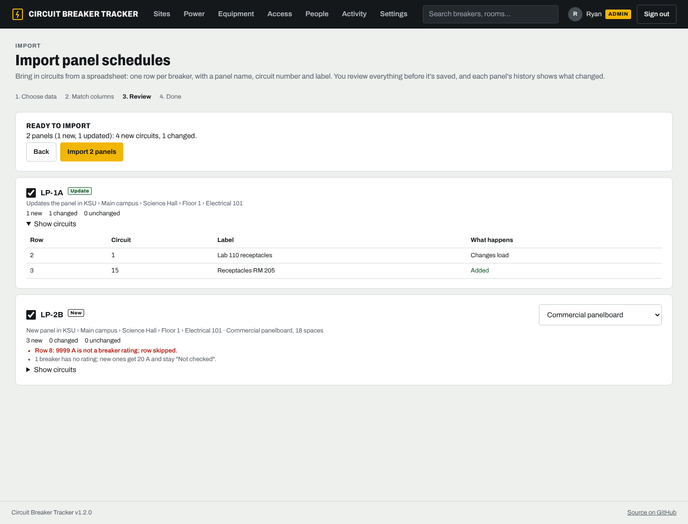                                  | 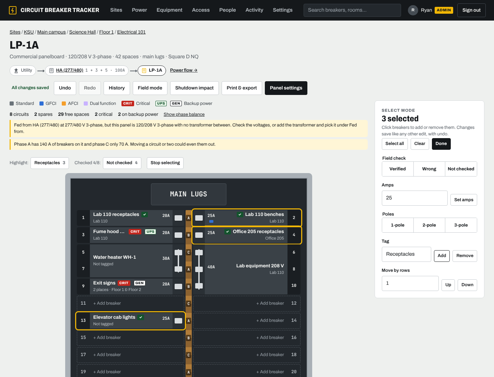                    |
| An import shows what each panel gains or changes before anything is saved.                             | Select several breakers to set amps, the field check or a tag together.                 |
| 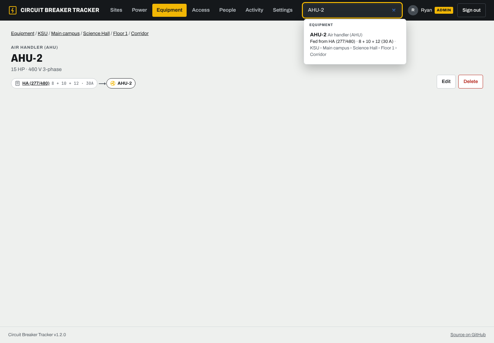                                      | 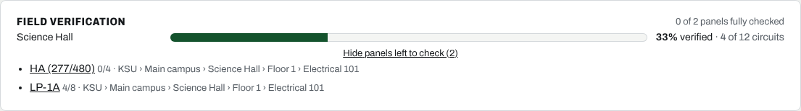              |
| "What feeds AHU-2?" is one search.                                                                     | How far field checking has got, building by building.                                   |

|                                                                             |                                                              |
| --------------------------------------------------------------------------- | ------------------------------------------------------------ |
| 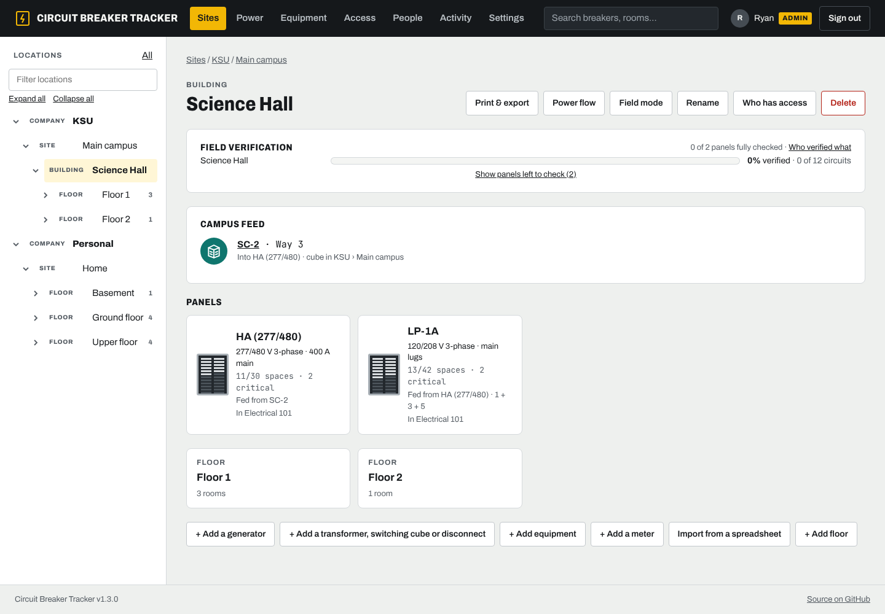               | 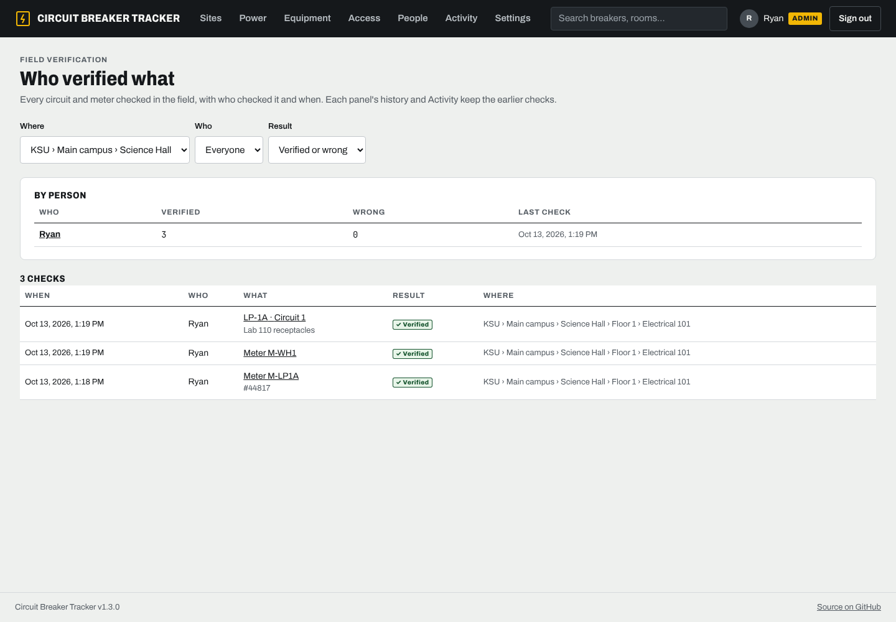 |
| A building ties back to switching cube SC-2, way 3, through its main panel. | Every check with who and when, and a count per person.       |

<p align="center">
  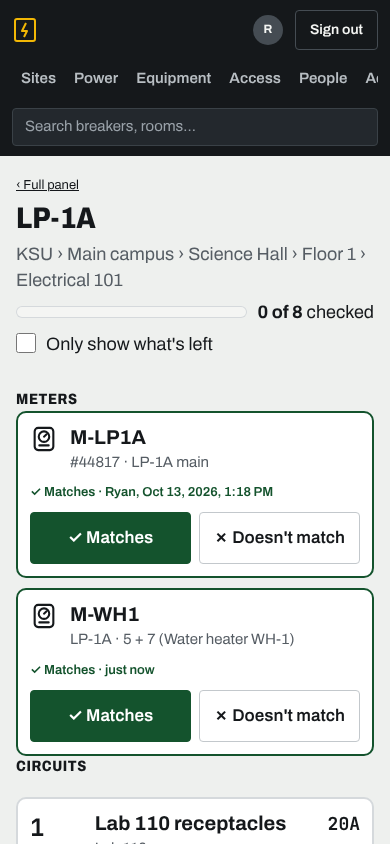
  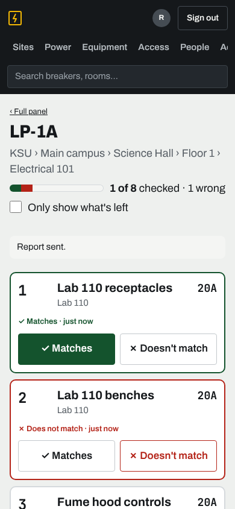
  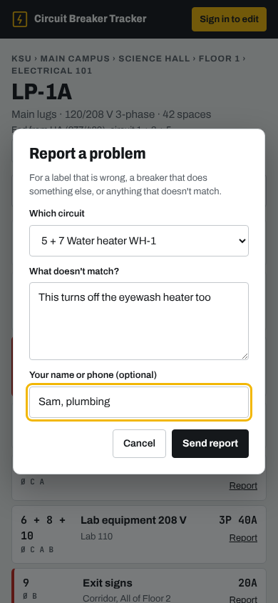
</p>

|                                                                                                                 |                                                                                |
| --------------------------------------------------------------------------------------------------------------- | ------------------------------------------------------------------------------ |
|                                                         |                      |
| The panel sheet: what every breaker serves, with markers, key and notes.                                        | The door card, sized to slip inside the panel door.                            |
|                                                           | 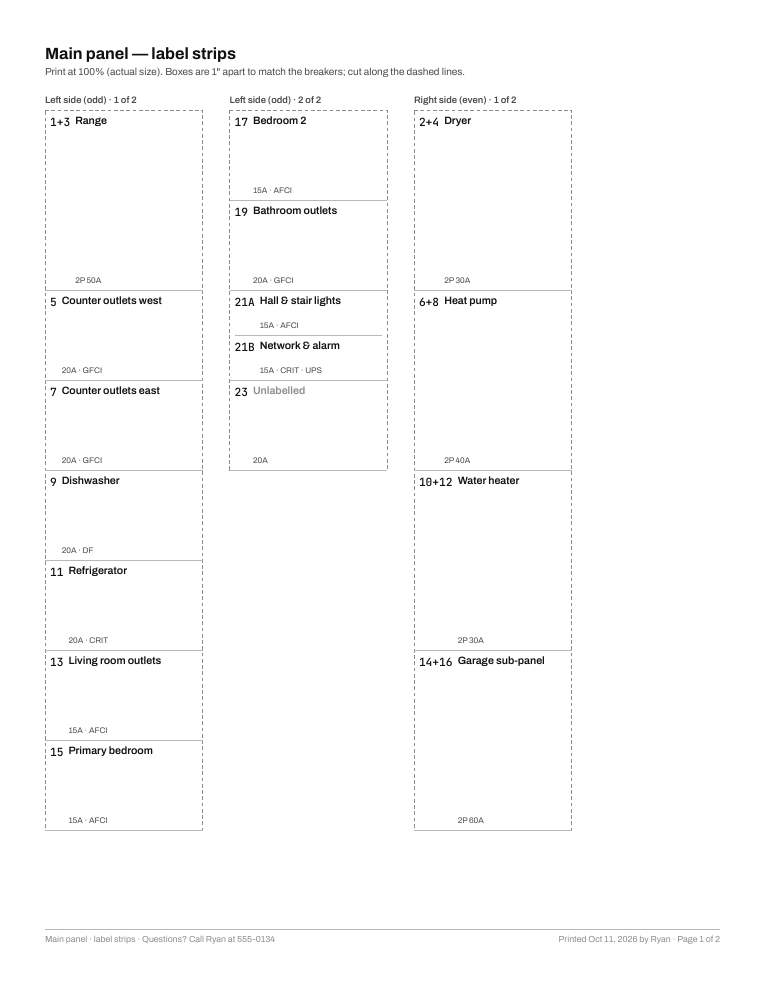         |
| Print a panel sheet, door card, sticker labels or label strips, on Letter or A4. A whole site prints as a book. | Label strips spaced to line up with the breakers, to stick beside each column. |
|                                                  |                 |
| A 120/208 V panelboard: phases A, B, C on the bus, 2- and 3-pole breakers.                                      | Its printed sheet, with a phase column down the middle.                        |

## Run it

```yaml
# docker-compose.yml
services:
  breakers:
    image: ghcr.io/rbibby53/circuit-breaker-tracker:latest
    restart: unless-stopped
    ports:
      - '2757:2757'
    volumes:
      - breakers-data:/data
volumes:
  breakers-data:
```

```sh
docker compose up -d
```

Open `http://<server>:2757`, create the first admin account on the setup screen, then go to
**Settings** to set the public address, reverse proxy, single sign-on and the rest. Upgrades are
a `docker compose pull && docker compose up -d`; the database updates itself on start.

## Documentation

| Guide                                      | For                                                                         |
| ------------------------------------------ | --------------------------------------------------------------------------- |
| [Install and upgrade](docs/install.md)     | Docker, Compose, Unraid, image tags, reverse proxies, upgrading             |
| [Configuration](docs/configuration.md)     | Every setting and its environment variable, logs, backups and restores      |
| [Sign-in](docs/sign-in.md)                 | Passwords, two-step codes, Microsoft Entra ID, Authentik, Keycloak, groups  |
| [User guide](docs/guide.md)                | Locations, panels, breakers, the power path, printing, field checks, import |
| [Access and roles](docs/access.md)         | Viewer, Editor, Manager and Admin; invites; what others see                 |
| [API for scripts](docs/api.md)             | Read-only API tokens, every endpoint, examples                              |
| [Troubleshooting](docs/troubleshooting.md) | When something doesn't work                                                 |
| [Architecture](docs/architecture.md)       | How the code fits together, for contributors                                |

### Scripts and API tokens

A script can read panels, breakers and locations with a read-only API token from **Your account
→ API tokens**. Every endpoint, with examples in Python, PowerShell and curl, is in
[docs/api.md](docs/api.md).

## Develop

Requirements: Node 24 (22 or newer works) and pnpm 12 (`npm install -g pnpm@12`; the exact version is pinned in `package.json`).

```sh
pnpm install
pnpm dev        # API on :2757 (data in apps/server/data), web on :5173 with a proxy to the API
pnpm test       # unit tests (core access rules) and API tests (server)
pnpm typecheck
pnpm build
```

Layout:

```
packages/core   Shared types, validation schemas and access rules (used by server and web)
apps/server     Fastify API, SQLite, sessions, SSO; serves the built web app
apps/web        React UI
docs/           User and admin guides, the plan and milestones
```

The access rules live in `packages/core/src/access.ts` and are covered by
`access.test.ts`. The server re-checks every request against them. How the rest fits together
is in [docs/architecture.md](docs/architecture.md).

## Contributing

See [CONTRIBUTING.md](CONTRIBUTING.md). Report security problems privately as described in
[SECURITY.md](SECURITY.md). Changes are listed in [CHANGELOG.md](CHANGELOG.md).

## License

GPL-3.0. See [LICENSE](LICENSE).
