# Circuit Breaker Tracker

[](https://github.com/rbibby53/Circuit-breaker-tracker/actions/workflows/ci.yml)
[](https://github.com/rbibby53/Circuit-breaker-tracker/pkgs/container/circuit-breaker-tracker)
[](LICENSE)

A self-hosted web app for recreating your electrical panels, labelling what every breaker
does, sharing them with the right people, and printing panel directories as PDFs. It runs
as a single Docker container with its data in one SQLite file.

> **Status:** milestones 1 to 4 of 5 are done: accounts, single sign-on, scoped access, the
> panel editor for residential load centers and commercial 3-phase panelboards, and printing.
> See [docs/PLAN.md](docs/PLAN.md) for the whole plan.

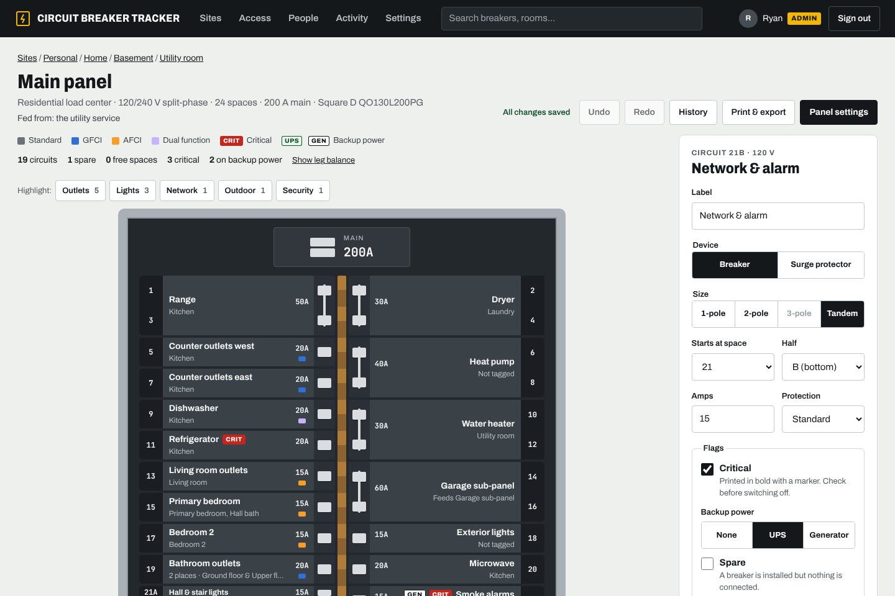

## What works today

- **Locations:** Company → Site → Building → Floor → Room. For homes, add floors straight
  to the site and the building level stays hidden.
- **Scoped access:** give someone **Viewer**, **Editor** or **Manager** on any location. A
  grant covers everything inside that location, and nothing outside it.
- **Manager invite limits:** a manager can only invite people inside their own scope, and
  only up to their limit (_Viewers only_, _Viewers and editors_, or _Up to managers_).
- **Two ways to sign in:** Microsoft Entra ID (or any OIDC provider), and local accounts
  with passwords for family, roommates and anyone without a work account.
- **Two-step sign-in** for password accounts: a code from an authenticator app, with
  one-time recovery codes. Whoever can send someone a reset link can also turn it off for
  them if they lose their phone.
- **Invite and reset links:** one-time links you copy and send yourself, so no email server
  is needed.
- **People page:** find anyone by name, email or location, and open **Manage access** to see
  everywhere they have access, change a role, remove access or grant a new location in one
  place, and set their name and email. You can also invite someone from there.
- **Profile pictures from [Gravatar](https://gravatar.com)** for people with an email: added
  under Your account, by an admin or manager under People, or from their Microsoft sign-in.
  Everyone else gets initials. Browsers fetch the pictures straight from
  gravatar.com using a hash of the email; admins can turn this off in Settings.
- **Where you're signed in:** Your account lists each browser with its address and when it
  was last used, and can sign out any of them or all the others. Managers and admins can sign
  someone out everywhere from People.
- **View as user:** admins can see the app exactly as someone else sees it, read-only.
- **Activity log:** every change is recorded. Managers see the changes inside their scope.
- **Panel editor** for residential load centers and commercial panelboards:
  - Odd spaces on the left, even on the right. Click an empty space to add a breaker, drag
    to move it, and pick 1-pole, 2-pole or tandem (21A / 21B).
  - **Three-phase panelboards** (120/208 V, 277/480 V): rows are labelled with phases A, B
    and C, and breakers can be 1-, 2- or 3-pole. Each breaker shows the phases it is on and
    its voltage (120 V, 208 V…). No tandems, and space counts come in multiples of 6 (30, 42,
    84…), as on real panelboards.
  - Set amps, protection (standard, GFCI, AFCI, dual function), a **critical** flag,
    **backup power** (UPS or generator) and spare.
  - Tag what each breaker **serves**: rooms on any floor, a whole floor or building, or
    the whole site.
  - Changes save automatically, with undo and redo (Ctrl+Z / Ctrl+Shift+Z). If two people
    edit at once, the second save is refused instead of silently overwriting.
  - **Tags** for what a breaker powers (Lights, Outlets, Servers…), suggested from tags already
    in use. Search finds breakers by tag, and a tag bar on each panel highlights every breaker
    with that tag.
  - **History** shows every change in plain words.
- **Surge protectors** that install in breaker spaces, with or without breakers of their own.
  They are marked SPD in the panel, on PDFs and in CSV exports.
- **Panel summary:** circuits, spares and free spaces under each panel, and how evenly
  breaker ratings are spread across the legs (split-phase) or phases A/B/C (3-phase).
- **Sub-panels:** set which breaker feeds a panel. Anyone who can see a panel also sees
  what feeds it, all the way up to the service, even when the upstream panels are outside
  their access.
- **Breakers serving a room:** each room and floor page lists every breaker that serves it,
  from any panel, including whole-floor and whole-site tags.
- **Print to PDF** (the **Print** button on any panel or location), with who printed it and
  when on every page:
  - **Panel sheet:** a full page laid out like the panel, odd numbers left and even right.
    It shows what each breaker serves, its markers and the panel's notes.
  - **Door card:** a 4-inch-wide card to cut out and keep inside the panel door.
  - **Breaker labels:** a sticker sheet with one label per circuit (Avery 5167 on Letter, Avery
    L7651 on A4), or strips to stick beside each column of breakers at 1" or ¾" spacing. Print
    these at 100%.
  - **Room index:** every room grouped by floor, with the breakers that serve it.
  - **Panel book:** a cover with contents, a sheet for every panel in a site, building or
    floor, then the room index.
  - Markers are printed as text (CRIT, UPS, GEN, GFCI, AFCI, DF, SPD), so they read fine in black
    and white. Each sheet has a QR code that opens the panel in the app.
  - US Letter or A4. People only ever print what they are allowed to see.
- **Public panel pages from the QR code:** a manager can let anyone who scans a panel's QR
  code see it without signing in. It is a read-only, phone-friendly list with a search box
  and a **Sign in to edit** button. The link is unguessable and can be replaced or turned
  off, and an admin can switch public pages off everywhere.
- **CSV export:** every breaker of a panel, or of everything under a location, for Excel,
  Numbers or Google Sheets (from the same **Print & export** button).
- **Duplicate a panel** into another room, e.g. for identical apartments. Room tags come
  along inside the same site.

## Screenshots

|                                                                        |                                                          |
| ---------------------------------------------------------------------- | -------------------------------------------------------- |
| 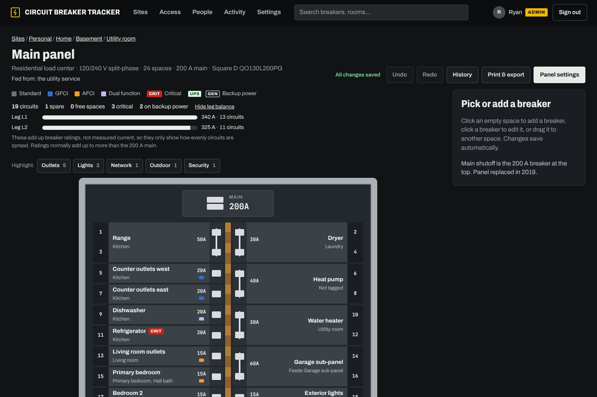                         | 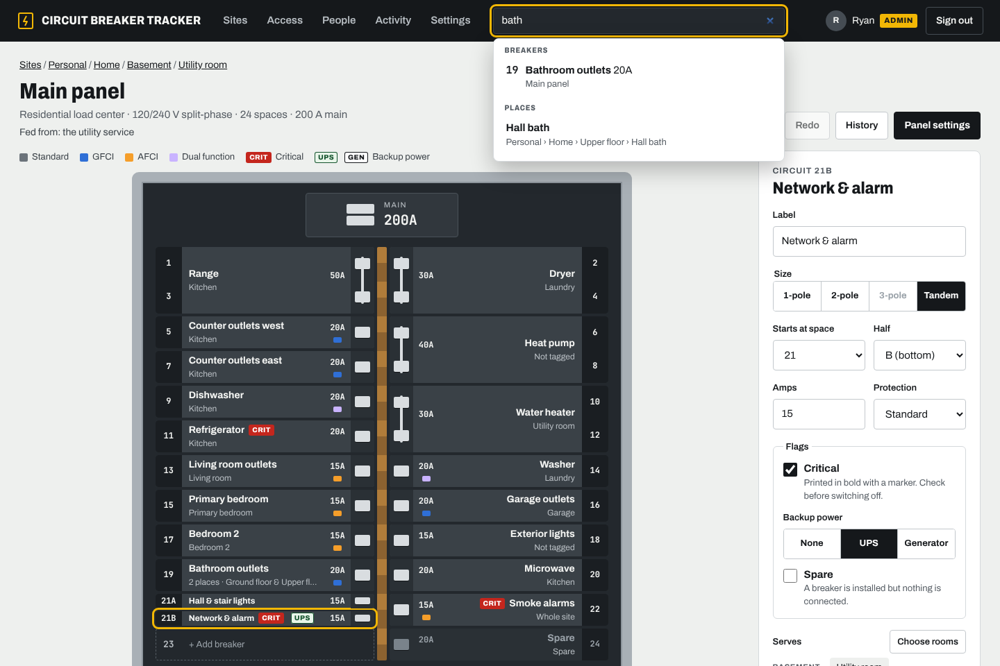   |
| Dark mode follows your system, or pick one under Account.              | Press <kbd>/</kbd> to search rooms, panels and breakers. |
| 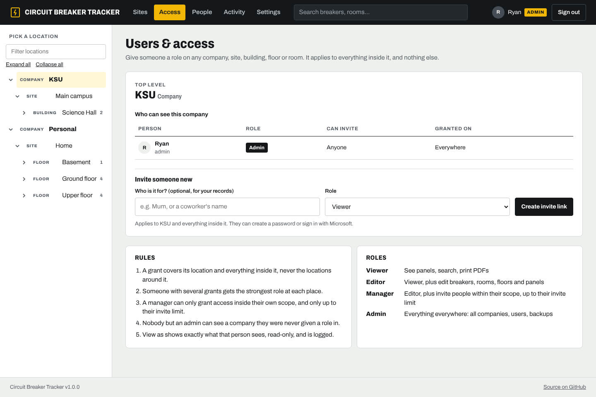                       | 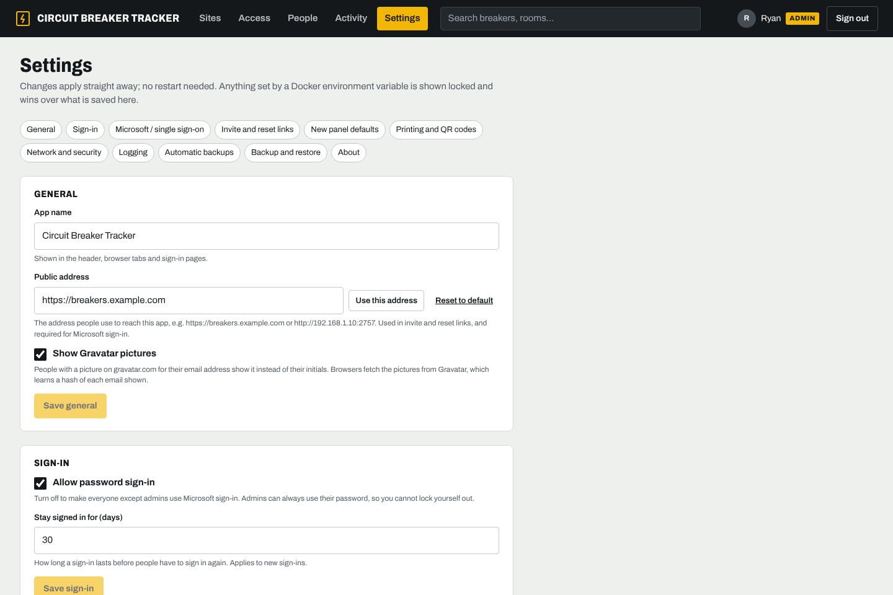               |
| Grant access on any location; managers only invite within their scope. | Admins configure the app in Settings instead of Docker.  |

<p align="center">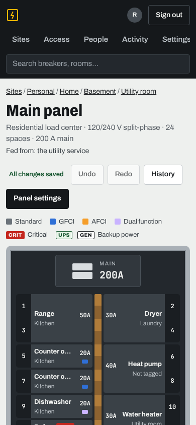</p>

|                                                                            |                                                                 |
| -------------------------------------------------------------------------- | --------------------------------------------------------------- |
| 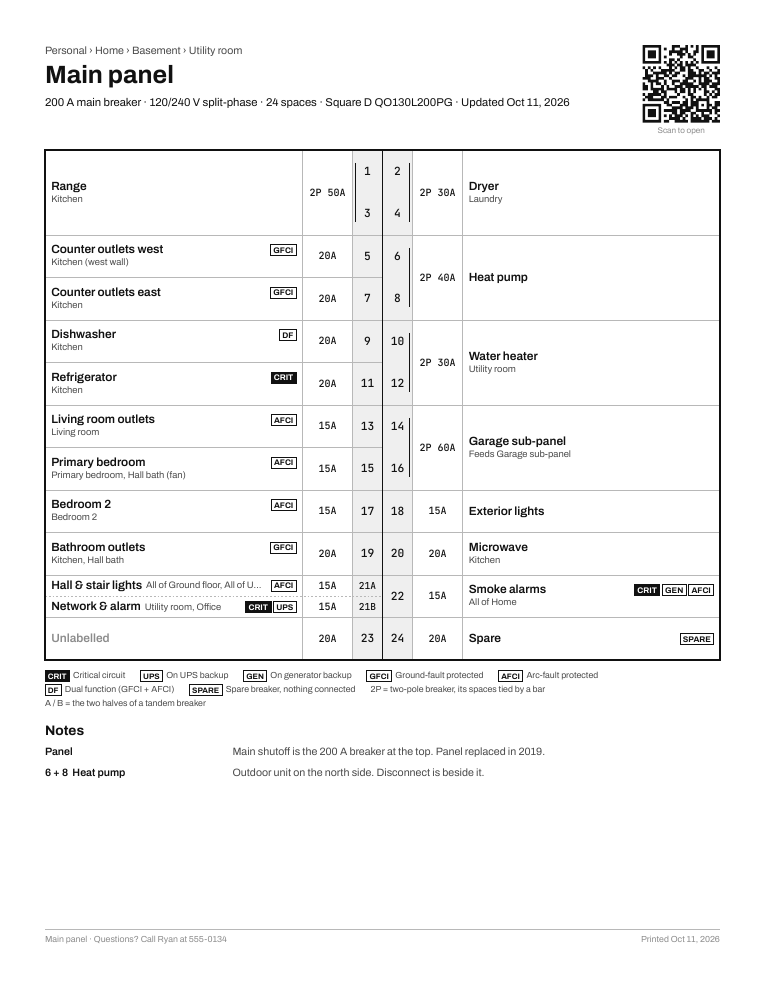                   | 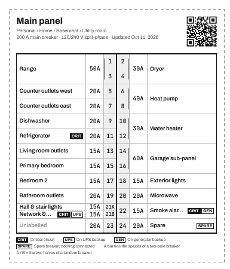      |
| The panel sheet: what every breaker serves, with markers, key and notes.   | The door card, sized to slip inside the panel door.             |
| 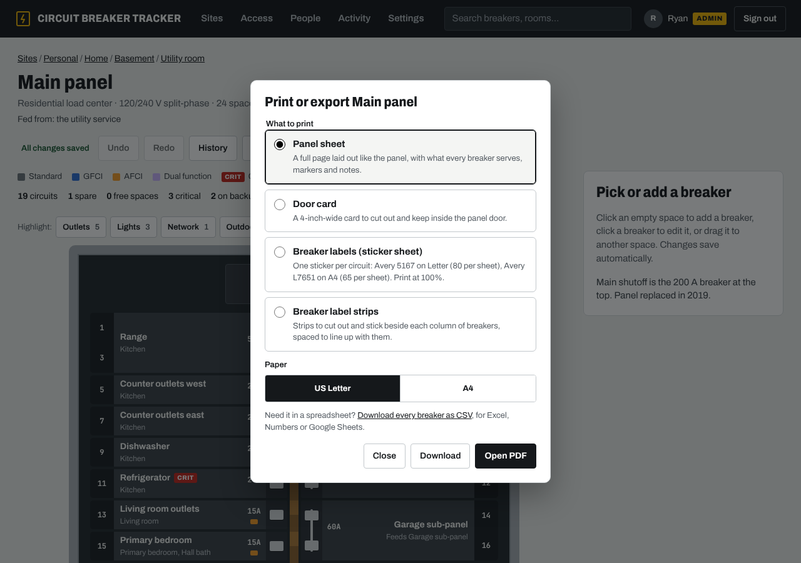                     |                                                                 |
| Print a whole site as a book, or just its room index, on Letter or A4.     |                                                                 |
| 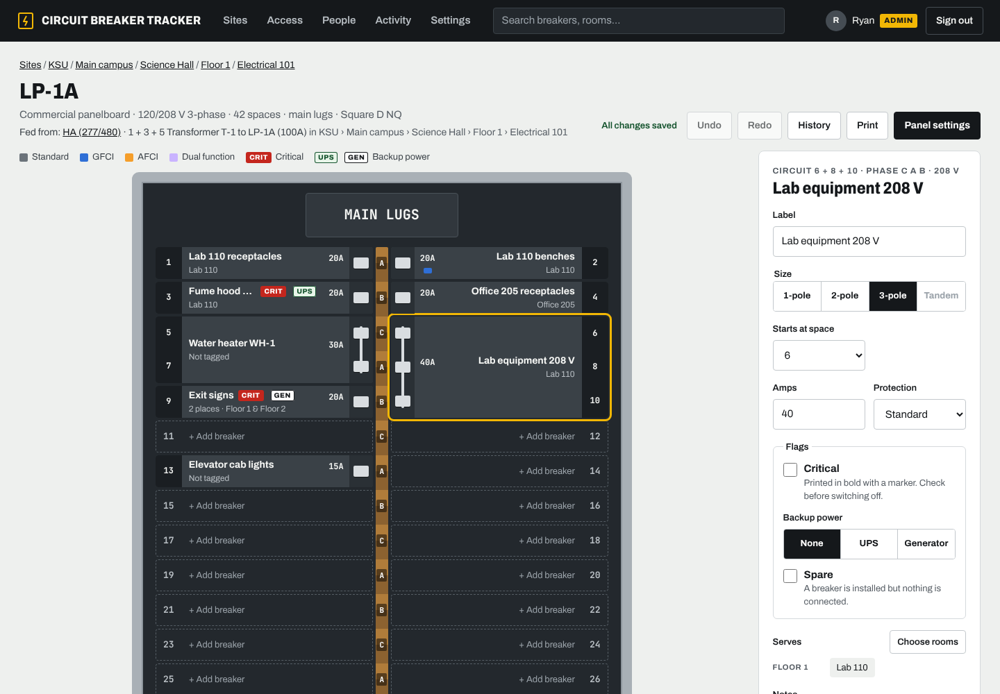            | 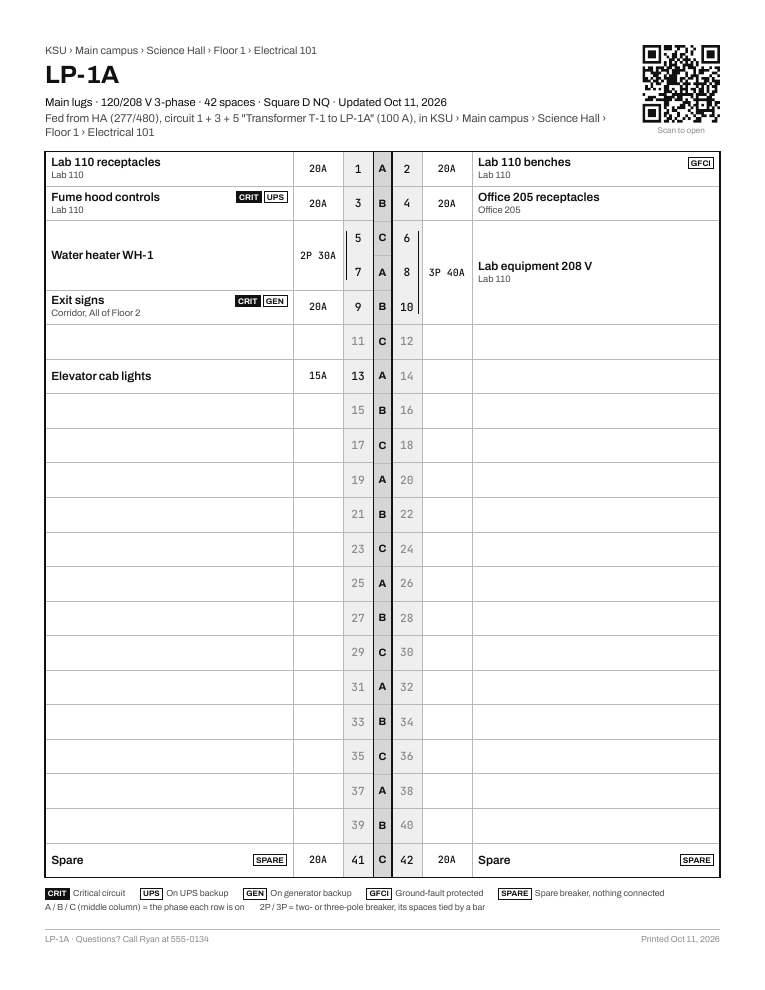 |
| A 120/208 V panelboard: phases A, B, C on the bus, 2- and 3-pole breakers. | Its printed sheet, with a phase column down the middle.         |

## Run it

```yaml
# docker-compose.yml
services:
  breakers:
    image: ghcr.io/rbibby53/circuit-breaker-tracker:latest
    restart: unless-stopped
    ports:
      - '2757:2757'
    volumes:
      - breakers-data:/data
volumes:
  breakers-data:
```

```sh
docker compose up -d
```

The app listens on port **2757** by default (it spells "BRKR" on a phone keypad, and little
else uses it). To run with the host's network instead of port mapping, and pick any free port:

```sh
docker run -d --name breakers --network host -e PORT=2757 -v breakers-data:/data \
  ghcr.io/rbibby53/circuit-breaker-tracker:latest
```

With `--network host`, `-p` mappings are ignored and `PORT` decides where it listens.

Open the app and create the first admin account on the setup screen, then go to **Settings**
to set the public address, reverse proxy, Microsoft sign-in and the rest. To build the image
yourself, use `docker build -t circuit-breaker-tracker .` or set `build: .` in the compose
file.

### Unraid

A template is in [`unraid/circuit-breaker-tracker.xml`](unraid/circuit-breaker-tracker.xml). It uses host networking
on port 2757.

1. In the Unraid terminal, create the data folder and give it to the container's user (uid 1000):
   ```sh
   mkdir -p /mnt/user/appdata/circuit-breaker-tracker && chown -R 1000:1000 /mnt/user/appdata/circuit-breaker-tracker
   ```
2. Save the template where Unraid looks for your own templates:
   ```sh
   curl -fsSL -o /boot/config/plugins/dockerMan/templates-user/my-circuit-breaker-tracker.xml \
     https://raw.githubusercontent.com/rbibby53/Circuit-breaker-tracker/main/unraid/circuit-breaker-tracker.xml
   ```
3. **Docker** tab → **Add Container** → pick **circuit-breaker-tracker** under Template → **Apply**.
4. Open `http://<server-ip>:2757`, create the first admin, then finish setup under **Settings**.

### Configuration

Docker only needs a port and a volume. Everything else is set by an admin on the **Settings**
page and applies without a restart.

| Docker variable                    | Default | Purpose                                                                                            |
| ---------------------------------- | ------- | -------------------------------------------------------------------------------------------------- |
| `PORT`                             | `2757`  | Port to listen on.                                                                                 |
| `DATA_DIR`                         | `/data` | Where `breakers.db` lives. Mount a volume here.                                                    |
| `ADMIN_USERNAME`, `ADMIN_PASSWORD` | (none)  | Create the first admin at startup instead of using the setup screen. Ignored once any user exists. |

Any setting can also be pinned with an environment variable. It then wins over the Settings page
and shows there as locked. This suits infrastructure-as-code setups:

| Setting                    | Variable                                                                 |
| -------------------------- | ------------------------------------------------------------------------ |
| App name                   | `APP_NAME`                                                               |
| Public address             | `PUBLIC_URL`                                                             |
| Allow password sign-in     | `ALLOW_LOCAL_LOGIN`                                                      |
| Stay signed in for (days)  | `SESSION_DAYS`                                                           |
| Microsoft / OIDC           | `OIDC_ISSUER`, `OIDC_CLIENT_ID`, `OIDC_CLIENT_SECRET`                    |
| SSO button text            | `OIDC_LABEL`                                                             |
| Invite / reset link expiry | `INVITE_DAYS`, `RESET_HOURS`                                             |
| New panel defaults         | `DEFAULT_PANEL_SPACES`, `DEFAULT_MAIN_AMPS`, `DEFAULT_VOLTAGE`           |
| Printing and QR codes      | `PAPER_SIZE` (`letter`, `a4`), `PRINT_QR`, `PRINT_NOTE`, `PUBLIC_PANELS` |
| Gravatar profile pictures  | `GRAVATAR`                                                               |
| Behind a reverse proxy     | `TRUST_PROXY`                                                            |
| HTTPS-only cookies         | `COOKIE_SECURE` (`auto`, `always`, `never`)                              |
| Log level                  | `LOG_LEVEL` (`error`, `warn`, `info`, `debug`)                           |
| Log format                 | `LOG_FORMAT` (`text`, `json`)                                            |
| Automatic backups          | `BACKUP_KEEP` (`0` = off, default 14), `BACKUP_HOUR` (0–23, default 3)   |

### Logs

The container log (Unraid's log viewer, `docker logs`) has one readable line per event, in the
container's time zone (`TZ`):

```
2026-10-11 14:05:09 INFO  Circuit Breaker Tracker 1.4.0 starting · Node v24.11.0 · times in this log are America/Chicago
2026-10-11 14:05:09 INFO  Database /data/breakers.db (1.2 MB, schema 6): 4 people, 31 locations, 6 panels, 212 breakers
2026-10-11 14:05:09 INFO  Sign-in: passwords, Microsoft / OIDC via login.microsoftonline.com · sessions last 30 days
2026-10-11 14:06:41 INFO  Signed in: ryan (password and two-step code) from 192.168.1.20
2026-10-11 14:07:02 INFO  ryan: Edited panel Main panel: Changed 14 label · Personal › Home › Basement › Utility room
2026-10-11 14:09:15 WARN  POST /api/auth/login → 403 in 98 ms · 192.168.1.31 · Sign-in refused for "sam": wrong password
```

- **Info** (the default) shows the start-up summary, sign-ins and sign-outs, every change (the
  same entries as the Activity page), clean-ups, and any problems with the reason.
- **Debug** adds a line for every request, with who made it. Health checks and static files
  are never logged.
- Link tokens and query strings are never written to the log.
- Set **Log format** to JSON for a log collector such as Loki or Graylog.

Both are under Settings → Logging and take effect without a restart. **Show recent log** there
lists the last 500 lines, so you can check what happened without opening the container console.

### Behind a reverse proxy

Point the proxy at port 2757, then turn on **Settings → Network and security → Behind a reverse
proxy** and set the public address to the proxy's https:// address.

Caddy:

```
breakers.example.com {
  reverse_proxy breakers:2757
}
```

Nginx:

```nginx
location / {
  proxy_pass http://breakers:2757;
  proxy_set_header Host $host;
  proxy_set_header X-Forwarded-For $proxy_add_x_forwarded_for;
  proxy_set_header X-Forwarded-Proto $scheme;
}
```

### Microsoft Entra ID sign-in

1. In the Entra admin center, go to **App registrations** and choose **New registration**.
   - **Supported account types:** accounts in this organizational directory only.
   - **Redirect URI:** platform _Web_. The exact value is shown on the Settings page, e.g.
     `https://breakers.example.com/api/auth/oidc/callback`.
2. Under **Certificates & secrets**, create a client secret.
3. In the app, open **Settings → Microsoft / single sign-on** and fill in:
   - **Issuer URL:** `https://login.microsoftonline.com/<directory-tenant-id>/v2.0`
   - **Client ID:** the application (client) ID
   - **Client secret:** the secret value
4. Save, then press **Test connection**.

Signing in with Microsoft does not give access to anything by itself:

- A new person still needs an invite link. They can accept it with Microsoft instead of a
  password.
- Existing local users can link their Microsoft account from **Account**.
- Accounts are matched by the provider's subject ID, never by email.

Local passwords keep working alongside SSO. To make everyone except admins use Microsoft,
turn off **Settings → Sign-in → Allow password sign-in**. Admins always keep their password, so
you cannot lock yourself out.

### Backups

Everything is in `/data/breakers.db`.

- **Automatic backups:** a copy is saved every day in `/data/backups`, at 03:00 in the
  container's time zone. The newest 14 are kept. Change the time and the number kept under
  **Settings → Automatic backups** (`BACKUP_HOUR`, `BACKUP_KEEP`; `0` turns them off). A
  backup missed while the server was off runs as soon as it is back. Each one is logged.
- **Saved backups** are listed under Settings, where you can download one, restore from it, or
  save one now. Your usual Unraid appdata backup picks up the folder as well.
- **Download a copy** from **Settings → Backup** at any time, even while people are using the
  app.

To restore, pick a saved backup or upload a backup file. The app shows what is in it before
anything changes, saves the current data as `breakers-before-restore-<date>.db` in the data
folder, then swaps the data in without a restart. Backups from older versions are upgraded
on the way in. Everyone is signed out and signs in with an account from the backup.

## Develop

Requirements: Node 24 (22 or newer works) and pnpm 12 (`npm install -g pnpm@12`; the exact version is pinned in `package.json`).

```sh
pnpm install
pnpm dev        # API on :2757 (data in apps/server/data), web on :5173 with a proxy to the API
pnpm test       # unit tests (core access rules) and API tests (server)
pnpm typecheck
pnpm build
```

Layout:

```
packages/core   Shared types, validation schemas and access rules (used by server and web)
apps/server     Fastify API, SQLite, sessions, SSO; serves the built web app
apps/web        React UI
docs/PLAN.md    The plan and milestones
```

The access rules live in `packages/core/src/access.ts` and are covered by
`access.test.ts`. The server re-checks every request against them.

## Contributing

See [CONTRIBUTING.md](CONTRIBUTING.md). Report security problems privately as described in
[SECURITY.md](SECURITY.md). Changes are listed in [CHANGELOG.md](CHANGELOG.md).

## License

GPL-3.0. See [LICENSE](LICENSE).
